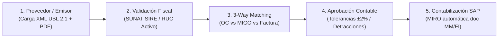
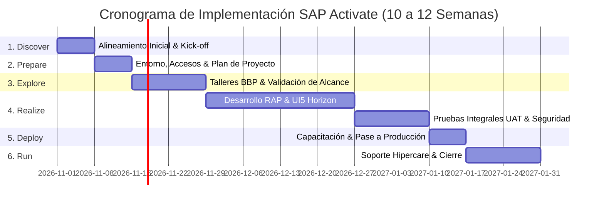

# Skill: Fiori-Functional-Architect (Alcance Funcional & Detalle Comercial SAP Fiori)

Esta skill define los estándares, metodologías corporativas, estructuras documentales y herramientas de generación automática para la elaboración de **Documentos de Alcance Funcional (FSD / Business Blueprint)** y **Propuestas Técnico-Comerciales** de alto impacto para las aplicaciones del Portal SAP Fiori bajo lineamientos de **Clean Core**, **SAP S/4HANA** y **SAP BTP**.

---

## 1. Perfil del Consultor y Objetivos de Documentación

El Consultor Funcional & Comercial de SAP Fiori actúa como puente estratégico entre el negocio, los usuarios clave (*Key Users*), el equipo técnico (*CDS-Architect*, *RAP-Engineer*, *Fiori-UI-Expert*, *Fiori-QA-Deployer*) y los tomadores de decisiones (*C-Level / Stakeholders*).

### Objetivos Esenciales:
1. **Definir el Alcance Funcional (In-Scope vs. Out-of-Scope):** Clarificar sin ambigüedades qué cubre cada sub-aplicación, qué reglas de negocio ejecuta y qué transacciones SAP estándar sustituye o potencia.
2. **Estructurar la Oferta Comercial Formal:** Transformar funcionalidades técnicas en valor tangible para el cliente: retorno de inversión (ROI), ahorro en horas-hombre, mitigación de riesgos fiscales y reducción de errores operativos.
3. **Planificar el Ciclo de Vida del Proyecto:** Diseñar cronogramas de implementación basados en **SAP Activate** con diagramas Gantt detallados, matrices de hitos de facturación y criterios de aceptación.
4. **Generar Entregables Profesionales Multi-Formato:** Crear propuestas en Markdown ejecutivo enriquecido y generar archivos formales en Word (`.docx`) listos para firma comercial.

---

## 2. Estructura Estándar: Documento de Alcance Funcional (FSD / BBP)

Todo Documento de Alcance Funcional debe seguir esta estructura corporativa:

### 2.1. Ficha Técnica de la Solución
* **Nombre de la Sub-Aplicación:** Ej. *Portal Proveedores Contabilidad — FI-AP & 3-Way Match*.
* **Código de Módulo:** Ej. `[07C]`.
* **Proceso de Negocio SAP:** Ej. *Procure-to-Pay (P2P) / Cuentas por Pagar (AP)*.
* **Transacciones SAP Sustituidas / Optimizadas:** Ej. `MIRO`, `FB60`, `MIR4`, `MIGO`, `ME23N`.
* **Usuarios Objetivo & Roles PFCG:** Ej. *Jefe de Contabilidad, Analista de Cuentas por Pagar, Auditor Tributario*.

### 2.2. Diagrama End-to-End del Flujo de Negocio (Mermaid)
Visualizar el recorrido completo de información entre actores y sistemas:


### 2.3. Desglose Funcional por Pantalla / Vista
Para cada vista de la sub-aplicación, detallar:
* **Propósito y Caso de Uso:** Cuándo y por qué el usuario accede a esta pantalla.
* **Campos y Filtros:** Datos de entrada, campos obligatorios, catálogos desplegables y ayudas de búsqueda (*F4*).
* **Acciones y Botones Operativos:** Acciones individuales y masivas (ej. *Revisión 3-Way Match*, *Validar SUNAT*, *Rechazar Factura*, *Exportar Excel*).
* **Reglas de Negocio & Validaciones:**
  - Tolerancias de precio y cantidad permitidas.
  - Comportamiento ante comprobantes con detracción SPOT o retención IGV.
  - Manejo de excepciones y flujos de rechazo motivado.

### 2.4. Matriz de Integración SAP & Datos Maestros
| Objeto de Negocio | Tabla SAP / CDS View | Transacción / BAPI / RAP Service | Sentido |
| :--- | :--- | :--- | :--- |
| Pedido de Compra | `EKKO` / `EKPO` | `I_PurchaseOrderAPI01` | Lectura SAP $\rightarrow$ Fiori |
| Entrada Mercancía | `MSEG` / `MKPF` | `I_GoodsMovementCube` | Lectura SAP $\rightarrow$ Fiori |
| Factura Proveedor | `RBKP` / `RSEG` | `ZUI_SUPPLIER_INVOICE_ACC_O4` | Bidireccional |
| Documento Contable | `BKPF` / `BSEG` | `C_SupplierInvoiceAccounting` | Escritura Fiori $\rightarrow$ SAP |

---

## 3. Estructura Estándar: Propuesta Técnico-Comercial & Business Case

### 3.1. Encabezado de la Oferta
* **Cliente:** Nombre de la empresa destinataria y áreas interesadas (TI, Operaciones, Finanzas).
* **Proveedor:** *Droid Consulting / JM Holding*.
* **Inversión Total:** Monto expresado en USD (sin IGV), indicando modalidad (SaaS / Llave en mano).
* **Vigencia de la Oferta:** Días calendario (típicamente 30 días).

### 3.2. Resumen Ejecutivo & Justificación Estratégica (C-Level)
* **Problemática Actual:** Diagnóstico de ineficiencias (ej. digitación manual, desvíos en precios, errores tributarios, falta de visibilidad en almacén).
* **Solución Propuesta:** Descripción concisa de la solución Fiori Horizon y arquitectura Clean Core.
* **Beneficios Cuantificables & Retorno de Inversión (ROI):**
  - Ahorro de tiempo estimado en horas-hombre mensuales (ej. 80 horas/mes).
  - Reducción porcentual de incidencias o reclamos (ej. -85%).
  - Período de recuperación de la inversión (ej. 4 a 6 meses).

### 3.3. Alcance de Implementación (In-Scope vs Out-of-Scope)
* **Dentro del Alcance (In-Scope):**
  - Despliegue de las pantallas y componentes Fiori Horizon.
  - Conexión e integración con backend SAP S/4HANA vía OData V4 / RAP.
  - Configuración de roles y catálogo de negocio en SAP Fiori Launchpad.
  - Pruebas unitarias, integrales (UAT) y capacitación a usuarios clave.
  - Garantía y soporte post-productivo (hipercare de 30 días).
* **Fuera del Alcance (Out-of-Scope):**
  - Modificaciones al estándar SAP ECC / S/4HANA no liberado.
  - Licenciamiento de productos de terceros no contemplados expresamente.
  - Infraestructura de hardware local o cableado estructurado.

---

## 4. Metodología de Implementación SAP Activate & Cronograma Gantt

Toda propuesta formal divide la ejecución en las 6 fases de **SAP Activate**:



### Matriz de Hitos y Facturación Vinculada
| Hito | Fase SAP Activate | Entregable Formal | Facturación (%) |
| :---: | :--- | :--- | :---: |
| **H1** | Firma de Contrato & Prepare | Acta de Inicio y Cronograma Aprobado | **30%** |
| **H2** | Explore | Documento de Alcance Funcional (FSD / BBP) firmado | **20%** |
| **H3** | Realize | Entrega de sistema configurado y pase a pruebas UAT | **25%** |
| **H4** | Deploy | Acta de Salida en Vivo (Go-Live) en Producción | **15%** |
| **H5** | Run | Cierre de Hipercare y Acta de Aceptación Final | **10%** |

---

## 5. Script Maestro: Generación Automática de Documentos Word (`.docx`) con Python

Para generar entregables formales con diseño corporativo SAP, utilizar `python-docx`:

```python
import docx
from docx.shared import Inches, Pt, RGBColor
from docx.enum.text import WD_ALIGN_PARAGRAPH
from docx.enum.table import WD_TABLE_ALIGNMENT
from docx.oxml import OxmlElement
from docx.oxml.ns import qn

def set_cell_background(cell, fill_hex):
    tcPr = cell._tc.get_or_add_tcPr()
    shd = OxmlElement('w:shd')
    shd.set(qn('w:val'), 'clear')
    shd.set(qn('w:color'), 'auto')
    shd.set(qn('w:fill'), fill_hex)
    tcPr.append(shd)

def create_proposal_docx(filename, title, client_name, amount_usd, modules_list):
    doc = docx.Document()
    
    # Configuración de márgenes estándar (1 pulgada)
    for section in doc.sections:
        section.top_margin = Inches(1)
        section.bottom_margin = Inches(1)
        section.left_margin = Inches(1)
        section.right_margin = Inches(1)

    # Título Principal
    p_title = doc.add_paragraph()
    p_title.alignment = WD_ALIGN_PARAGRAPH.CENTER
    run_title = p_title.add_run(title)
    run_title.font.name = 'Arial'
    run_title.font.size = Pt(20)
    run_title.font.bold = True
    run_title.font.color.rgb = RGBColor(10, 37, 64) # SAP Dark Blue

    # Metadatos del Proyecto
    p_meta = doc.add_paragraph()
    p_meta.alignment = WD_ALIGN_PARAGRAPH.CENTER
    run_meta = p_meta.add_run(f"Cliente: {client_name} | Inversión: ${amount_usd:,.2f} USD (Sin IGV)\nArquitectura SAP Fiori Horizon & Clean Core")
    run_meta.font.name = 'Arial'
    run_meta.font.size = Pt(10)
    run_meta.font.color.rgb = RGBColor(100, 116, 139)

    doc.add_heading('1. Resumen Ejecutivo y Objetivos', level=1)
    doc.add_paragraph(
        "El presente documento formaliza el alcance funcional y la propuesta de servicios profesionales "
        "para la implementación de la solución sobre la plataforma SAP Fiori Launchpad corporativa."
    )

    doc.add_heading('2. Módulos Funcionales Incluidos', level=1)
    table = doc.add_table(rows=1, cols=3)
    table.alignment = WD_TABLE_ALIGNMENT.CENTER

    hdr_cells = table.rows[0].cells
    headers = ['ID Módulo', 'Nombre del Módulo', 'Alcance Operativo']
    for idx, text in enumerate(headers):
        hdr_cells[idx].text = text
        set_cell_background(hdr_cells[idx], '0A2540')
        hdr_cells[idx].paragraphs[0].runs[0].font.bold = True
        hdr_cells[idx].paragraphs[0].runs[0].font.color.rgb = RGBColor(255, 255, 255)

    for item in modules_list:
        row = table.add_row().cells
        row[0].text = item['id']
        row[1].text = item['name']
        row[2].text = item['desc']

    doc.save(filename)
    print(f"Documento generado exitosamente: {filename}")
```

---

## 6. Catálogo de Referencia de los 12 Módulos para Fichas Funcionales

| ID | Nombre de Solución | Proceso SAP | Beneficio Principal para el Cliente |
| :---: | :--- | :--- | :--- |
| **00** | Demand Planning SAP | SAP C4C / IBP | Proyección comercial predictiva y analítica de demanda de clientes. |
| **01** | Requerimientos SolMan | Solution Manager 7.2 | Gobernanza TI, control de cambios y auditoría de desarrollos ABAP. |
| **02** | Control de FUE & Usuarios | BASIS / Licenciamiento | Optimización de licencias S/4HANA y perfiles de autorización SUIM. |
| **03** | Pedidos de Venta SD | SAP SD (VA01/VA03) | Gestión integral comercial, ATP HANA y resolución de bloqueos. |
| **04** | Dashboard Incidentes AI | SAP Joule AI / ITSM | SLA de soporte técnico inteligente asistido por IA generativa. |
| **05** | SAP WMS - SRM FIORI | SAP WM / MM | Control ágil de almacenes, stock por bin, OTs e impresión de etiquetas. |
| **07** | Portal de Proveedores | SAP MM-FI / B2B | Autoservicio web para registro de facturas electrónicas y guías. |
| **07C**| Portal Proveedores Contabilidad | SAP FI-AP / MIRO | Back-office contable: 3-Way Matching, validación SUNAT SIRE y MIRO directa. |
| **08** | Entregas a Rendir y Viáticos | SAP FI-TV | Rendición de gastos de viaje, anticipos y validación de comprobantes. |
| **11** | Gestión de Tipo de Cambio | SAP FI (TCURR) | Automatización diaria de tipos de cambio SUNAT/SBS y tablas TCURR. |
| **12** | CRM Portal de Clientes | SAP C4C / CX | Portal autoservicio de clientes VIP, oportunidades y encuestas Qualtrics. |
| **13** | Libros Legales & SIRE | Localización Perú | Cumplimiento PLE 5.1, 6.1, 8.1, 14.1 y módulos RCE/RVIE SUNAT. |
| **14** | Indicadores WMS Multi-Sede | Logística / Torre Control | Ocupabilidad LX03, flujo MB51, OTs abiertas LT23 y despacho Drivin. |
| **15** | Gestión de Transporte TM | SAP TM / Flota | Monitoreo de flota pesada, planificación de carga y tracking en ruta. |
| **16** | Procure Core (Ariba Clone) | Source-to-Settle | Licitaciones RFX, subastas inversas, Guided Buying y contratos marco. |
| **17** | Mapa 3D de Almacén | Gemelo Digital 3D | Visualización 3D de 1.200 nichos, semáforo de vencimiento y muelles. |
