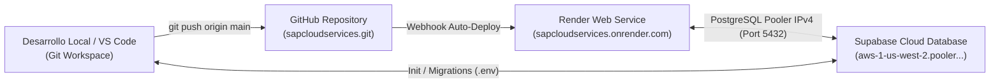

# Skill: Fiori-QA-Deployer (Calidad, Pruebas, Consistencia UX & Despliegue Clean Core)

Esta skill define los controles de calidad técnica, auditoría de consistencia de interfaz de usuario y procedimientos de despliegue para garantizar la conformidad con las directrices de Clean Core en SAP S/4HANA y SAP BTP.

---

## 1. Verificación Estática con ABAP Test Cockpit (ATC)

Todo desarrollo backend debe superar la variante de verificación **ABAP Cloud / Clean Core**:

- **Perfil de Verificación:** `ABAP_CLOUD_DEVELOPMENT_DEFAULT`
- **Reglas Críticas:**
  - `NO_UNRELEASED_API`: No utilizar funciones, clases o tablas no liberadas bajo contrato C1.
  - `NO_DIRECT_DB_MODIFICATION`: Modificaciones a tablas estándar deben realizarse vía Business Object Interface (BOI) o RAP EML, nunca mediante `UPDATE` o `INSERT` directo.
  - `NO_OBSOLETE_STATEMENTS`: Prohibido el uso de `CALL FUNCTION 'ENQUEUE_*'`, `COMMIT WORK` explícito dentro de behavior pools, o `MOVE-CORRESPONDING` sin control de tipo.

---

## 2. Checklist de Auditoría de Consistencia Visual y UX Fiori Horizon

Antes de autorizar el despliegue o entrega de cualquier subaplicación del Portal, el auditor de QA debe verificar:

| Punto de Control | Estándar Obligatorio | Verificación |
| :--- | :--- | :--- |
| **Barra Lateral Izquierda** | Formato `sap.tnt.SideNavigation`: Fondo blanco `#ffffff`, borde derecho `1px solid #eaedf1`, ancho `230px`. | ✅ / ❌ |
| **Elemento Activo en Sidebar** | Recuadro azul Fiori Horizon (`border: 1.5px solid #0a6ed1; border-radius: 6px; background: #ffffff; color: #0a6ed1;`). | ✅ / ❌ |
| **Iconografía en Sidebar** | Iconos outline Slate `#475569` (activo en `#0a6ed1`). **Cero emojis** en menús o botones. | ✅ / ❌ |
| **Agrupadores Expandibles** | Separador y chevron `\|  >`, con rotación a 90° (`v`) al expandirse. | ✅ / ❌ |
| **Pie de Barra Lateral** | Item `Administración` anclado al fondo con `border-top: 1px solid #eaedf1`. | ✅ / ❌ |
| **Franja Superior de KPIs** | 4 tarjetas uniformes con métrica de color funcional: Naranja `#e06a3b` (pendientes), Slate `#1e293b` (total base), Verde `#107e3e` (cumplimiento %), Naranja `#e06a3b` (críticos). | ✅ / ❌ |
| **Cabecera Shell Bar** | Fondo `#1d2d3e`, Logo SAP, botón `< Home` con handler `goHome()`, buscador y acciones. | ✅ / ❌ |
| **Modo Iframe vs Standalone** | Regla `body.in-iframe` para ocultar la cabecera embebida cuando se visualiza en modal. | ✅ / ❌ |
| **Sincronización de Temas** | Soporte de mensajes `postMessage` (`SET_THEME`) para alternar `sap_horizon` y `sap_horizon_dark`. | ✅ / ❌ |

---

## 3. Pruebas Unitarias Transaccionales (ABAP Unit con Test Doubles)

Aislamiento de base de datos y verificación de operaciones RAP:

```abap
CLASS ltcl_orden_unit DEFINITION FINAL FOR TESTING
  DURATION SHORT
  RISK LEVEL HARMLESS.

  PRIVATE SECTION.
    CLASS-DATA:
      environment TYPE REF TO if_caching_test_environment.

    CLASS-METHODS:
      class_setup,
      class_teardown.

    METHODS:
      test_crear_orden_draft FOR TESTING,
      test_aprobar_orden FOR TESTING.
ENDCLASS.

CLASS ltcl_orden_unit IMPLEMENTATION.

  METHOD class_setup.
    cl_cds_test_environment=>create(
      i_for_entities = VALUE #( ( entity_name = 'R_GESTIONORDEN' ) ) ).
  ENDMETHOD.

  METHOD class_teardown.
    cl_cds_test_environment=>destroy_all( ).
  ENDMETHOD.

  METHOD test_crear_orden_draft.
    MODIFY ENTITIES OF R_GestionOrden
      ENTITY Orden
        CREATE FIELDS ( OrdenID Descripcion Estado )
        WITH VALUE #( ( %cid        = 'CID_01'
                        OrdenID     = 'ORD-2026-001'
                        Descripcion = 'Orden de Prueba de QA'
                        Estado      = 'PENDIENTE' ) )
      MAPPED   DATA(mapped)
      FAILED   DATA(failed)
      REPORTED DATA(reported).

    cl_abap_unit_assert=>assert_initial( failed-orden ).
    cl_abap_unit_assert=>assert_not_initial( mapped-orden ).
  ENDMETHOD.

  METHOD test_aprobar_orden.
    " Ejecutar acción de negocio y verificar resultado
    " ...
  ENDMETHOD.

ENDCLASS.

CLASS ltcl_supplier_invoice_unit DEFINITION FINAL FOR TESTING
  DURATION SHORT
  RISK LEVEL HARMLESS.

  PRIVATE SECTION.
    CLASS-DATA:
      environment TYPE REF TO if_caching_test_environment.

    CLASS-METHODS:
      class_setup,
      class_teardown.

    METHODS:
      test_three_way_match_tolerance FOR TESTING,
      test_post_to_sap_fi FOR TESTING,
      test_reject_invoice FOR TESTING.
ENDCLASS.

CLASS ltcl_supplier_invoice_unit IMPLEMENTATION.

  METHOD class_setup.
    cl_cds_test_environment=>create(
      i_for_entities = VALUE #( ( entity_name = 'R_SUPPLIERINVOICEACCOUNTING' )
                                ( entity_name = 'R_SUPPLIERINVOICEITEMACCOUNTING' ) ) ).
  ENDMETHOD.

  METHOD class_teardown.
    cl_cds_test_environment=>destroy_all( ).
  ENDMETHOD.

  METHOD test_three_way_match_tolerance.
    " Simular factura con varianza de precio de 1.5% (dentro de tolerancia +/-2%)
    MODIFY ENTITIES OF R_SupplierInvoiceAccounting
      ENTITY Factura
        EXECUTE executeThreeWayMatch
        FROM VALUE #( ( %cid_ref = 'CID_INV_01' ) )
      RESULT DATA(matched_results)
      FAILED DATA(failed).

    cl_abap_unit_assert=>assert_initial( failed-factura ).
  ENDMETHOD.

  METHOD test_post_to_sap_fi.
    " Simular contabilizacion MIRO generando doc SAP FI y MM
    MODIFY ENTITIES OF R_SupplierInvoiceAccounting
      ENTITY Factura
        EXECUTE postToSAPFI
        FROM VALUE #( ( %cid_ref = 'CID_INV_01' ) )
      RESULT DATA(post_results)
      FAILED DATA(failed).

    cl_abap_unit_assert=>assert_initial( failed-factura ).
  ENDMETHOD.

  METHOD test_reject_invoice.
    " Simular rechazo motivado
    MODIFY ENTITIES OF R_SupplierInvoiceAccounting
      ENTITY Factura
        EXECUTE rechazarFactura
        FROM VALUE #( ( %cid_ref = 'CID_INV_01'
                        %param   = VALUE #( motivo = 'Discrepancia en Precio' ) ) )
      FAILED DATA(failed).

    cl_abap_unit_assert=>assert_initial( failed-factura ).
  ENDMETHOD.

ENDCLASS.
```

---

## 4. Matriz de Configuración SAP Fiori Launchpad (FLP)

Para el pase a producción, documentar y registrar los siguientes parámetros en el Launchpad App Manager:

| Parámetro FLP | Valor Ejemplo | Descripción |
| :--- | :--- | :--- |
| **Semantic Object** | `GestionOrdenes` | Objeto de negocio para navegación basada en intención. |
| **Action** | `manage` / `display` | Acción a ejecutar sobre el objeto semántico. |
| **Application Type** | `SAPUI5 Fiori App` / `Fiori Elements` | Tipo de componente web a instanciar. |
| **SAPUI5 Component ID** | `com.empresa.gestionordenes` | ID declarado en el `manifest.json`. |
| **Business Catalog** | `SAP_BR_OPERACIONES_BC` | Catálogo de negocio donde se publica el Tile. |
| **Business Role (PFCG)** | `Z_BR_OPERACIONES_MGR` | Rol de autorizaciones asignado al usuario final. |
| **Semantic Object (AP)** | `SupplierInvoiceAccounting` | Portal Proveedores Contabilidad — FI-AP & 3-Way Match. |
| **Action (AP)** | `manage` | Gestión y contabilización de comprobantes de pago. |
| **Application Type (AP)** | `SAPUI5 Fiori App` | Floorplan Freestyle modular con 7 vistas y barra SideNav Horizon. |
| **SAPUI5 Component ID (AP)**| `com.empresa.portalproveedorescontabilidad` | ID raíz de la aplicación de contabilidad. |
| **Business Catalog (AP)** | `SAP_BR_AP_ACCOUNTANT_BC` | Catálogo de Especialista en Cuentas por Pagar. |
| **Business Role (AP)** | `Z_BR_AP_ACCOUNTANT` | Rol de autorizaciones PFCG para equipo contable. |
| **Semantic Object (3D)** | `Warehouse3D` | Mapa 3D de Almacén — Gemelo Digital & Semáforo. |
| **Action (3D)** | `manage` / `display` | Visualización volumétrica de nichos y control de lotes. |
| **Application Type (3D)** | `WebGL / HTML5 Fiori App` | Three.js con OrbitControls y controles Horizon. |
| **SAPUI5 Component ID (3D)**| `com.empresa.mapaalmacen3d` | ID raíz de la aplicación del Gemelo Digital 3D. |
| **Business Catalog (3D)** | `SAP_BR_WAREHOUSE_MGR_BC` | Catálogo de Jefe de Centro de Distribución y Almacenes. |
| **Business Role (3D)** | `Z_BR_WAREHOUSE_3D_LEAD` | Rol de autorizaciones PFCG para monitoreo volumétrico. |

---

## 5. Pruebas Automatizadas de Interfaz (OPA5 & QUnit)

Validación de flujos de navegación en frontend:

```javascript
sap.ui.define([
  "sap/ui/test/Opa5",
  "sap/ui/test/opaQunit"
], function (Opa5, opaTest) {
  "use strict";

  QUnit.module("Navegación Fiori Horizon & 3-Way Match");

  opaTest("Debe alternar entre vistas desde la barra lateral SideNavigation", function (Given, When, Then) {
    Given.iStartMyApp();

    When.onTheSidebar.iClickNavItem("dashboard");
    Then.onTheDashboard.iShouldSeeTheKpiStripWithFourCards();

    When.onTheSidebar.iClickNavItem("invoicesMatch");
    Then.onTheInvoicesMatch.iShouldSeeTheTable();

    When.onTheInvoicesMatch.iClickReviewButton();
    Then.onTheReviewDialog.iShouldSeeSplitPdfAndXmlViewer();

    When.onTheSidebar.iClickNavItem("sunatSire");
    Then.onTheSunatSire.iShouldSeeSireStatusTable();

    Given.iTeardownMyApp();
  });
});

```

---

## 6. Pipeline de Despliegue Continuo (CI/CD) & Sincronización Multi-Nube

Este proyecto implementa una arquitectura cloud de alta disponibilidad (24/7) donde el código fuente, la infraestructura de ejecución y la base de datos pública están desacoplados y sincronizados automáticamente:



### Arquitectura de Componentes
1. **Control de Versiones & Pipeline (GitHub):**
   - Repositorio: `https://github.com/jmerino2015/sapcloudservices.git`
   - Rama principal de producción: `main`.
   - Cada commit empujado a `main` dispara automáticamente la compilación del Dockerfile y el despliegue sin caída de servicio en Render.

2. **Infraestructura de Hosting 24/7 (Render):**
   - URL de Producción: `https://sapcloudservices.onrender.com`
   - Configuración: `Dockerfile` basado en `node:20-alpine` (`ENV PORT=8080`, `EXPOSE 8080`).
   - Variables de Entorno requeridas en Render Dashboard:
     * `DATABASE_URL`: Cadena de conexión al pooler de Supabase.
     * `NODE_ENV`: `production`.

3. **Capa de Persistencia de Datos (Supabase PostgreSQL):**
   - Servidor Pooler IPv4: `aws-1-us-west-2.pooler.supabase.com:5432`
   - Base de datos: `postgres`
   - **Regla Crítica de Redes:** NUNCA utilizar el dominio directo `db.vsuqjewodogswexkbcqr.supabase.co` en entornos que carezcan de soporte IPv6 nativo. Siempre utilizar el Connection Pooler transaccional o de sesión en el puerto `5432` o `6543`.

### Protocolo de Actualizaciones Futuras
Cuando se realicen nuevos desarrollos, modificaciones de tablas o adición de datos maestros:

1. **Definir DDL:** Agregar las tablas en `src/db/schema.sql` usando nomenclatura Clean Core `ztb_*`.
2. **Definir Dataset:** Incorporar los nuevos registros demo en `src/db/seed_data.js`.
3. **Idempotencia en Database:** Implementar la lógica de inserción segura en `src/db/database.js` usando `ON CONFLICT (...) DO NOTHING` o `DO UPDATE` para evitar fallos por claves duplicadas.
4. **Verificación Local:** Ejecutar `node src/db/init.js` para migrar y poblar Supabase en frío.
5. **Pase a Producción:**
   ```bash
   git add .
   git commit -m "feat(<modulo>): <descripcion de cambios y datos>"
   git push origin main
   ```
6. **Auditoría Post-Despliegue:**
   - Verificar estado del conector: `GET https://sapcloudservices.onrender.com/api/db/status`
   - Verificar que los nuevos registros aparezcan en los endpoints respectivos (`/api/gr`, `/api/gi`, etc.).

---

## 7. Protocolo de Auditoría y Verificación para Aplicaciones WebGL / 3D en Fiori

Para autorizar el despliegue de componentes 3D intensivos (como `apps/17_mapa_almacen_3d`):

1. **Gestión de Memoria y Ciclo de Vida WebGL:**
   - Todo objeto de escena `THREE.Mesh`, geometría `THREE.BufferGeometry` y material `THREE.Material` debe liberarse explícitamente (`dispose()`) al cerrar el modal iframe del Launchpad para prevenir fugas de memoria en la GPU.
2. **Operación 100% Offline (Zero CDN Leakage):**
   - Librerías core (`Three.js`, `OrbitControls.js`, `SheetJS xlsx.full.min.js`) deben estar empaquetadas en `assets/` local para asegurar compatibilidad en redes bancarias o industriales con cortafuegos estrictos.
3. **Auditoría Visual de Banners Multimedia (Cero Duplicados):**
   - Verificar en `js/apps-config.js` que ninguna tarjeta comparta imagen con otra de la misma categoría temática.
   - Todo banner debe cumplir las dimensiones exactas `728x360` JPEG con compresión $\le 95\text{ KB}$ para mantener tiempos de carga sub-segundo en el Launchpad.


