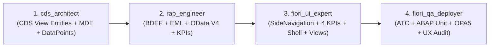

# ECOSYSTEM FIORI & RAP CLEAN CORE — AGENT TEAM & GUIDELINES

Este proyecto cuenta con un equipo especializado de 4 agentes de IA para el ciclo de vida completo de desarrollo de aplicaciones SAP Fiori bajo la arquitectura **ABAP RESTful Application Programming Model (RAP)** y lineamientos estrictos de **Clean Core** (SAP S/4HANA y SAP BTP).

---

## 👥 EQUIPO DE SUB-AGENTES ESPECIALIZADOS

| Agente | ID / Invocación | Rol Principal | Enfoque Clean Core & Estándar Fiori Horizon |
| :--- | :--- | :--- | :--- |
| **CDS-Architect** | `cds_architect` | Modelador de Datos Semánticos & VDM | CDS View Entities (`R_*`, `I_*`, `C_*`), MDE desacopladas, Push-down HANA, DataPoints para franja analítica KPI |
| **RAP-Engineer** | `rap_engineer` | Lógica Transaccional & Servicios RAP | BDEF con Draft, Behavior Pools ABAP Cloud, EML, cálculo de KPIs, OData V4 |
| **Fiori-UI-Expert** | `fiori_ui_expert` | Experiencia de Usuario & Frontend | Fiori Elements, SAPUI5 Freestyle, `sap.tnt.SideNavigation`, franja cromática 4 KPIs, Shell Bar unificado, `manifest.json` |
| **Fiori-QA-Deployer** | `fiori_qa_deployer` | Calidad, Seguridad & Despliegue | ABAP Test Cockpit (ATC), ABAP Unit / OPA5, Auditoría de Consistencia Visual UX Horizon, Launchpad App Manager, gCTS/BTP |

---

## 🔄 FLUJO SECUENCIAL DE TRABAJO (HANDOFF PIPELINE)

1. **Paso 1: `cds_architect`**
   - Modela la jerarquía VDM: `R_` (Base/Root con persistencia), `I_` (Interface) y `C_` (Consumption/Projection transaccional).
   - Genera los archivos Metadata Extension (`.mde`) con anotaciones `@UI.*` 100% desacopladas.
   - Incorpora campos de auditoría, control de concurrencia y ETag (`@Semantics.systemDateTime.localInstanceLastChangedAt`).
   - Define dataPoints semánticos para alimentar la franja de métricas KPI.
   - Realiza el handoff técnico hacia `rap_engineer`.

2. **Paso 2: `rap_engineer`**
   - Diseña el archivo de definición de comportamiento `BDEF` (`managed with draft`, `strict(2)`, `lock master`, `authorization master`).
   - Implementa los Behavior Pools (`LCL_HANDLER`, `LCL_SAVER`) con métodos EML, validaciones y determinaciones.
   - Programa la lógica de cálculo de métricas para la consola ejecutiva.
   - Configura `Service Definition` y `Service Binding` en protocolo **OData V4 - UI**.
   - Realiza el handoff técnico hacia `fiori_ui_expert`.

3. **Paso 3: `fiori_ui_expert`**
   - Configura el descriptor de aplicación `manifest.json` (modelos OData V4, enrutamiento, targets).
   - Diseña la barra lateral izquierda bajo el estándar **SAP Fiori Horizon `sap.tnt.SideNavigation`**:
     * Fondo blanco `#ffffff`, borde derecho `1px solid #eaedf1`, ancho `230px`.
     * Elemento activo con marco azul distintivo (`border: 1.5px solid #0a6ed1; border-radius: 6px; color: #0a6ed1; font-weight: 600;`).
     * Iconos outline Slate Gray (`#475569`, activo `#0a6ed1`). **Cero emojis** en menús.
     * Agrupadores expandibles con indicador vertical y chevron (`|  >`), rotando 90° (`v`) al expandir.
     * Pie fijo inferior con botón `Administración` anclado con `border-top: 1px solid #eaedf1`.
   - Implementa la franja de **4 Tarjetas KPI** con código de color funcional:
     * KPI 1: Naranja/Coral (`#e06a3b`) para elementos pendientes / abiertos.
     * KPI 2: Dark Slate (`#1e293b`) para volumen total o base instalada.
     * KPI 3: Verde (`#107e3e`) para porcentaje de ocupabilidad, calidad o cumplimiento.
     * KPI 4: Naranja/Coral (`#e06a3b`) para lotes por vencer, incidentes o excepciones.
   - Configura la Shell Bar superior (`#1d2d3e`, Logo SAP, botón `< Home` con `goHome()`, buscador y acciones).
   - Soporte de temas Fiori Horizon (`sap_horizon` y `sap_horizon_dark`) vía listener `postMessage`.
   - Realiza el handoff técnico hacia `fiori_qa_deployer`.

4. **Paso 4: `fiori_qa_deployer`**
   - Ejecuta auditoría estática con perfiles ATC de ABAP Cloud (`ABAP_CLOUD_DEVELOPMENT_DEFAULT`).
   - Audita el checklist de consistencia visual UX Horizon (SideNavigation, KPI Strip, Shell Bar, cero emojis).
   - Diseña pruebas unitarias aisladas (`ABAP Unit` con test doubles) y pruebas de interfaz (`OPA5 / QUnit`).
   - Define el catálogo de negocio, Semantic Objects y Target Mappings para el SAP Fiori Launchpad.
   - Establece la gobernanza de transporte y despliegue a SAP BTP / S/4HANA.

---

## 🛡️ PRINCIPIOS DE GOBERNANZA CLEAN CORE & UX HORIZON

1. **Uso Exclusivo de ABAP Cloud:**
   - Prohibido el uso de sentencias obsoletas (`CALL FUNCTION`, direct `SELECT *` sobre tablas estándar no liberadas).
   - Utilizar únicamente APIs y CDS Views con contrato de liberación **C1 (Released for Key User / ABAP Cloud)**.
2. **Desacoplamiento Estricto UI / Lógica / Datos:**
   - Cero anotaciones `@UI.*` en las vistas CDS; todas residen en archivos `.mde`.
   - La lógica de negocio no reside en la interfaz de usuario ni en triggers de base de datos; reside en el Behavior Pool RAP.
3. **Draft Obligatorio en Aplicaciones Transaccionales:**
   - Toda aplicación Fiori transaccional implementa Draft (`managed with draft`) para resiliencia y auto-guardado.
4. **Protocolo OData V4 por Defecto:**
   - Toda nueva exposición de servicio se realiza en OData V4 para máximo rendimiento y soporte de operaciones en lote / metadatos enriquecidos.
5. **Uniformidad Visual Fiori Horizon Obligatoria:**
   - Todas las aplicaciones del portal comparten idéntica barra lateral `sap.tnt.SideNavigation`, paleta de colores para KPIs, iconos outline sobrios y botón interactivo `< Home`.
