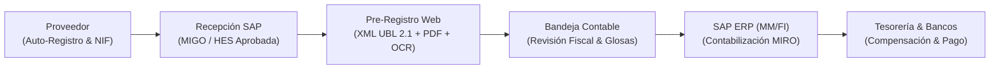
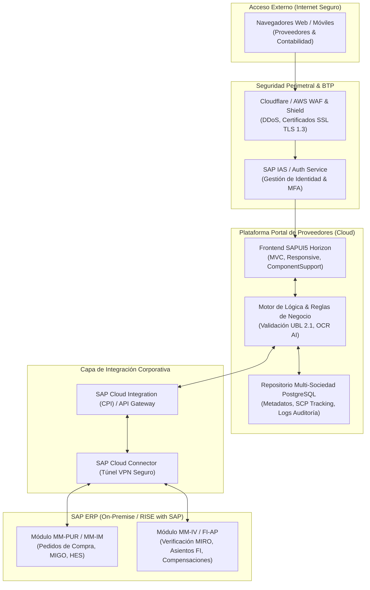
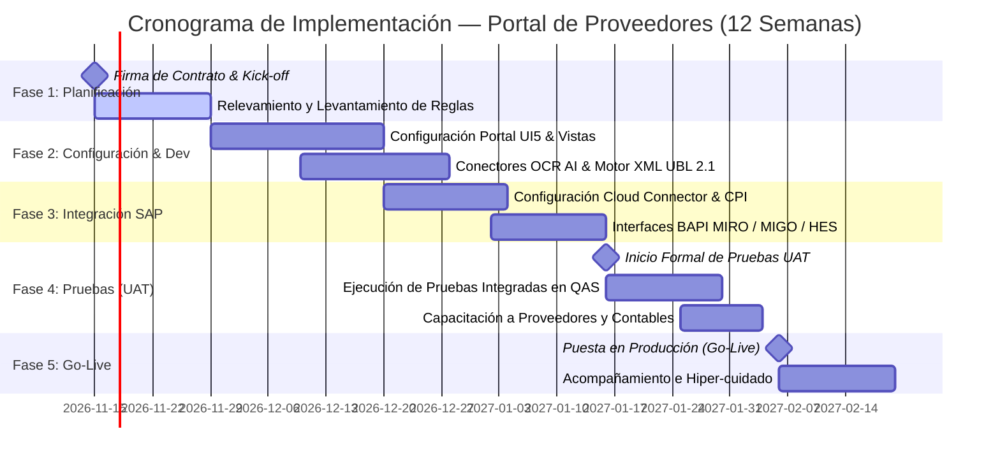

# PROPUESTA TÉCNICO-COMERCIAL & DOCUMENTO DE ALCANCE
## PORTAL DE PROVEEDORES SAP B2B (PROCURE-TO-PAY)
### Automatización de Facturación Electrónica, 3-Way Matching y Pagos con SAP S/4HANA & ECC

---

> [!NOTE]
> **Datos Generales de la Propuesta**
> * **Cliente:** Dirección de Abastecimiento, Gerencia de Finanzas y Gerencia de TI
> * **Solución:** Portal de Proveedores B2B Cloud — SAP Fiori Horizon & Clean Core Architecture
> * **Inversión Total:** **\$35,000 USD** (Treinta y cinco mil dólares americanos, sin incluir IGV)
> * **Modalidad de Facturación:** Hitos vinculados a entregables (Firma de Contrato, Inicio de Pruebas, Puesta en Producción)
> * **Vigencia de la Oferta:** 30 días calendario

---

## 1. RESUMEN EJECUTIVO Y OBJETIVOS DEL PROYECTO

El presente documento constituye la propuesta técnico-comercial y definición formal de alcance para la implementación del **Portal de Proveedores SAP B2B**. 

La plataforma tiene como propósito central optimizar y digitalizar de punta a punta la relación transaccional con la red de proveedores, descentralizando el registro de comprobantes de pago (facturas electrónicas XML/PDF y notas de crédito), asegurando la verificación tributaria en tiempo real y garantizando la contabilización directa en el ERP SAP mediante validación cruzada (**3-Way Matching**: Orden de Compra — Entrada de Mercancía/Aceptación de Servicio — Factura).

### Beneficios Estratégicos Cuantificables:
* **Eliminación del 100% de la digitación manual** en cuentas por pagar para facturas referenciadas a pedidos.
* **Cero discrepancias tributarias:** Validación obligatoria del formato oficial **XML UBL 2.1**, estado del RUC (*Activo*) y condición de domicilio (*Habido*).
* **Autoservicio para proveedores:** Reducción del 85% de llamadas y correos de consulta de cobranza mediante visibilidad 24/7 de historial de facturas, retenciones, detracciones y bancos pagadores.
* **Agilidad contable:** Integración automática con las transacciones de logística y finanzas de SAP (**MIGO / HES / MIRO / FB60**).

---

## 2. ALCANCE FUNCIONAL DETALLADO DE LA SOLUCIÓN

La plataforma está desarrollada sobre el sistema de diseño estándar **SAP Fiori Horizon**, con arquitectura responsiva (PC, Tablet y Móvil) y modular por roles.

---

### Módulo 1: Acceso, Seguridad y Auto-Registro de Proveedores
Permite a los proveedores incorporarse al ecosistema sin fricciones administrativas, validando su identidad tributaria contra las bases corporativas.

* **Auto-Registro Descentralizado:** Captura de NIF (RUC de 11 dígitos), Razón Social, Correo Corporativo, Tipo de Emisor (*Electrónico* o *Físico*), Datos del Contacto y Contraseña cifrada.
* **Validación de Seguridad:** Flujo de confirmación por correo electrónico (*SAP Identity Authentication Service / IAS*) antes de la habilitación de credenciales.
* **Control de Acceso Multi-Factor (MFA) & SSL:** Cifrado de extremo a extremo para garantizar la confidencialidad de la información tributaria.

---

### Módulo 2: Panel de Control & Analítica KPI para Proveedores
Tablero ejecutivo que provee al proveedor una vista consolidada de su desempeño, documentos en tránsito y métricas de servicio.

* **Franja de Indicadores de Gestión:**
  * **Cumplimiento OTIF:** Nivel de entregas a tiempo y completas (*On-Time In-Full*).
  * **SLA de Contabilización:** Tiempo promedio de aprobación por parte de Contabilidad (días transcurridos).
  * **Efectividad DROID OCR / XML:** Tasa de éxito en la lectura y validación automática de comprobantes.
  * **Acumulado Fiscal:** Monitoreo gráfico de facturas pendientes, montos pagados en el mes y detracciones depositadas.
* **Acceso Directo a Sub-módulos:** Botones de acción rápida para Pre-Registro, Consulta de Facturas y Pagos.

---

### Módulo 3: Pre-Registro de Facturas con Validación MIGO/HES y Lectura OCR
Corazón operativo del portal para la radicación digital de comprobantes fiscales nacionales.

* **Filtro y Selección de Entradas Pendientes:** Listado de Entradas de Mercancía (**MIGO**) y Hojas de Entrada de Servicio (**HES**) pendientes de facturar.
* **Regla Anti-Duplicados:** Control estricto que impide asociar un comprobante a una posición de entrega que ya posea factura registrada.
* **Asistente de Lectura OCR Inteligente:** Extracción automatizada desde el PDF de sustento de campos críticos: Razón Social, Sociedad SAP, Serie-Correlativo SUNAT, Monto Neto, IGV (18%), Monto Total y detección del **Sello de Recepción de Tienda/Almacén**.
* **Validación y Parseo de XML UBL 2.1:** Carga obligatoria del XML para proveedores electrónicos, extrayendo impuestos, monedas y firmas de validación.
* **Generación de Trazabilidad SCP:** Al guardar, se genera un código de correlativo único de seguimiento (ej. `P1000000XXX`) y la factura pasa automáticamente a la bandeja contable.

---

### Módulo 4: Consola de Contabilidad, Verificación y Contabilización SAP ERP
Bandeja de trabajo para el equipo de Cuentas por Pagar (*Accounts Payable*), eliminando la captura manual en el ERP.

* **Bandeja Centralizada de Comprobantes Pre-Registrados:** Filtros avanzados por RUC, Razón Social, Rango de Fechas, Estado y Número de Pedido.
* **Inspección de Documentos Digitales:** Visualización y descarga inmediata del PDF y XML adjuntos por el proveedor.
* **Modificación de Parámetros Fiscales:** Capacidad del contador para ajustar fecha de contabilización, tipo/porcentaje de detracción (Banco de la Nación), indicador de retención de IGV y glosas contables.
* **Contabilización Transaccional en SAP:** Con un solo clic se dispara la contabilización interna equivalente a la transacción **MIRO** en SAP ERP, retornando en pantalla el **Documento SAP MM**, el **Documento FI** y el **Ejercicio Contable**.
* **Flujo de Rechazo Motivado:** En caso de discrepancia, el contador registra un motivo específico (ej. *"PDF adjunto no corresponde"* o *"Monto no coincide con OC"*), notificando al proveedor y permitiendo la corrección y reenvío.

---

### Módulo 5: Historial de Facturas y Órdenes de Compra
Módulo de auditoría y consulta dual para el seguimiento exhaustivo de compromisos comerciales.

* **Pestaña Facturas:** Relación histórica con detalle de N° Comprobante, Tipo, Documento Contable SAP, Fecha Emisión, Fecha Vencimiento, Monto Detracción, Retención, IGV y Total Facturado.
* **Pestaña Órdenes de Compra:** Consulta detallada de posiciones por pedido de compra (OC), con cantidades solicitadas, entregadas, facturadas y saldos pendientes.
* **Exportación de Datos:** Descarga de reportes en formato estándar Microsoft Excel (.xlsx).

---

### Módulo 6: Historial de Pagos, Retenciones, Detracciones y Bancos
Transparencia total en el proceso de liquidación financiera hacia los proveedores.

* **Ventana de Consulta Histórica:** Consulta por rango de fechas de hasta 1 año de antigüedad.
* **Información Bancaria de Cancelación:** Identificación del **Banco Pagador** (BCP, BBVA, Interbank, Scotiabank), fecha valor de pago y N° Documento de Compensación de Tesorería SAP.
* **Desglose de Descuentos Fiscales:** Detalle explícito de montos retenidos y montos de detracción depositados ante SUNAT / Banco de la Nación.
* **Reporte de Pagos Exportable:** Generación de la constancia de pago y resumen financiero en Excel.

---

### Módulo 7: Registro de Notas de Crédito (Devolución de Mercadería y Ajustes)
Módulo especializado para la gestión de disminuciones de deuda comercial y ajustes logísticos (Req. N° 1 BPD).

* **Modalidades Soportadas:**
  * **NC por Devolución de Stock:** Asociada a la Nota de Devolución de Compras y salida de almacén en SAP.
  * **NC por Ajuste de Importe:** Descuentos comerciales, penalidades o correcciones de tarifa sin movimiento físico.
* **Trazabilidad Contable:** Registro del Folio SUNAT de la Nota de Crédito, Orden de Compra relacionada y generación del correspondiente asiento contable de abono en SAP.

---

### Módulo 8: Asistente Virtual Inteligente SAP Joule Droid
Asistente con Inteligencia Artificial generativa y contextual embebido en la barra lateral del portal.

* **Atención 24/7 sin Intervención Humana:** Responde consultas en lenguaje natural sobre:
  * *"¿Cuál es el estado de mi factura F001-0063045?"*
  * *"¿Qué órdenes de compra tengo pendientes de entrega?"*
  * *"¿Cuándo se procesa mi pago de la factura contabilizada ayer?"*
  * *"¿Cómo ingreso una nota de crédito por devolución?"*
* **Chips de Sugerencia Rápida:** Atajos a un solo clic para facturas, órdenes, pagos y comprobantes.

---

## 3. ARQUITECTURA DE INTEGRACIÓN Y SEGURIDAD

La arquitectura del Portal de Proveedores se basa en el principio **Clean Core**, manteniendo el núcleo del ERP SAP intacto y realizando toda la interacción a través de capas de integración seguras y certificadas.

### Componentes de la Arquitectura:
1. **Frontend SAPUI5 Responsive:** Compatible con Google Chrome, Microsoft Edge, Safari y navegadores móviles. Tema `sap_horizon` nativo sin librerías invasivas.
2. **Capa de Conectividad SAP (Cloud Connector + CPI):** Comunicación cifrada hacia SAP sin abrir puertos entrantes en el firewall corporativo del cliente.
3. **Persistencia & Repositorio de Documentos:** Almacenamiento seguro de metadatos y archivos binarios (XML/PDF) con segregación lógica por sociedad.
4. **Seguridad y Cumplimiento Normativo:**
   * Cifrado en tránsito (**HTTPS / TLS 1.3**) y en reposo (**AES-256**).
   * Autenticación Multi-Factor (**MFA**) para mitigar riesgos de suplantación.
   * Registro de auditoría transaccional para trazabilidad ante revisiones fiscales.

---

## 4. CRONOGRAMA DE IMPLEMENTACIÓN Y FASES

El proyecto se estructura en un plazo planificado de **12 semanas calendario**, asegurando una transición controlada hacia producción.

| Fase | Duración | Actividades Clave | Entregables Principales |
| :--- | :---: | :--- | :--- |
| **Fase 1: Kick-off & Exploración** | Semanas 1 a 2 | • Alineamiento metodológico y plan de trabajo. • Relevamiento de tablas de detracciones, retenciones y sociedades SAP. • Definición de catálogo de usuarios y conectividad inicial. | • Acta de Kick-off. • Documento BPD / Especificación de Integración. |
| **Fase 2: Construcción & Configuración** | Semanas 3 a 5 | • Despliegue de vistas Fiori Horizon (8 módulos). • Configuración del motor de lectura OCR y parseo UBL 2.1. • Implementación de reglas anti-duplicados y cálculo de impuestos. | • Ambiente DEV/QAS del Portal configurado. • Pruebas unitarias de carga XML/PDF aprobadas. |
| **Fase 3: Integración SAP ERP** | Semanas 6 a 8 | • Configuración de túnel SAP Cloud Connector. • Construcción de flujos CPI / servicios OData para MIGO/HES/MIRO. • Integración de datos de compensación y bancos pagadores. | • Conectividad end-to-end certificada entre Portal y SAP QAS. • Ejecución exitosa de BAPI de pre-registro y contabilización. |
| **Fase 4: Pruebas de Usuario (UAT)** | Semanas 9 a 10 | • **Hito: Inicio de Pruebas de Aceptación (UAT)**. • Pruebas funcionales con proveedores piloto y usuarios de contabilidad. • Ajustes menores y capacitación a usuarios clave. | • Matriz de casos de prueba UAT firmada. • Manuales de usuario (Rol Proveedor y Rol Contador). |
| **Fase 5: Despliegue a Producción (Go-Live)** | Semanas 11 a 12 | • **Hito: Puesta en Producción (Go-Live)**. • Migración a ambiente productivo conectado a SAP PRD. • Envío masivo de invitaciones a proveedores. • Soporte full-time en sitio/remoto (hiper-cuidado de 2 semanas). | • Acta de Pase a Producción. • Portal operativo en URL corporativa definitiva. • Informe final de cierre de proyecto. |

---

## 5. PROPUESTA ECONÓMICA E HITOS DE FACTURACIÓN

La inversión global por la consultoría, licenciamiento base, implementación, integración SAP y acompañamiento en puesta en producción es de:

$$\mathbf{\text{Inversión Total: } \$35,000.00 \text{ USD (Neto)}}$$

*(No incluye Impuesto General a las Ventas - IGV. Precios fijados en Dólares Americanos).*

### Esquema de Hitos de Facturación:
Los pagos se realizarán vinculados al cumplimiento estricto de los siguientes hitos verificables:

| Hito | Evento Disparador / Entregable | % | Importe (USD) |
| :---: | :--- | :---: | :---: |
| **Hito 1** | **Firma de Contrato:** Formalización del acuerdo contractual, entrega del plan de trabajo definitivo y realización de la reunión de Kick-off. | **35%** | **\$12,250.00 USD** |
| **Hito 2** | **Inicio de Pruebas (UAT):** Portal desplegado e integrado con el ambiente SAP QAS, interfaces probadas y entrega formal de credenciales para el inicio del testing de aceptación de usuarios. | **35%** | **\$12,250.00 USD** |
| **Hito 3** | **Puesta en Producción (Go-Live):** Despliegue operativo conectado al ambiente SAP PRD, primera contabilización real ejecutada con éxito y firma del Acta de Go-Live. | **30%** | **\$10,500.00 USD** |
| **TOTAL** | **Cumplimiento Integral del Proyecto** | **100%** | **\$35,000.00 USD** |

---

## 6. PREMISAS Y RESPONSABILIDADES

### Responsabilidades del Cliente:
* Facilitar los accesos y credenciales necesarios para los ambientes SAP DEV, QAS y PRD.
* Asignar un usuario de tipo comunicación/integrador en SAP con permisos para ejecución de BAPIs/OData de compras y facturación (**MIGO / HES / MIRO / FB60**).
* Disponer del servidor / máquina virtual para la instalación y configuración del agente **SAP Cloud Connector**.
* Coordinar la participación de usuarios líderes de Contabilidad y Abastecimiento durante la etapa de pruebas (UAT).

### Responsabilidades del Proveedor de Solución:
* Entrega e instalación de la totalidad de componentes de software descritos en el alcance.
* Configuración completa de la interfaz de usuario en SAP Fiori Horizon y modelos de integración.
* Capacitación técnica y funcional a los equipos de TI y Contabilidad.
* Periodo de soporte y estabilización post-productiva (**Hypercare**) de **2 semanas continuas** tras el Go-Live.
* Garantía técnica sobre el código entregado por un periodo de **3 meses** ante defectos o vicios ocultos de configuración.

---

> [!TIP]
> **Aprobación de la Propuesta**
> Para proceder con el inicio formal del proyecto y calendarización de la reunión de Kick-Off, favor de remitir la orden de servicio o contrato firmado con base en los términos expuestos en este documento.
