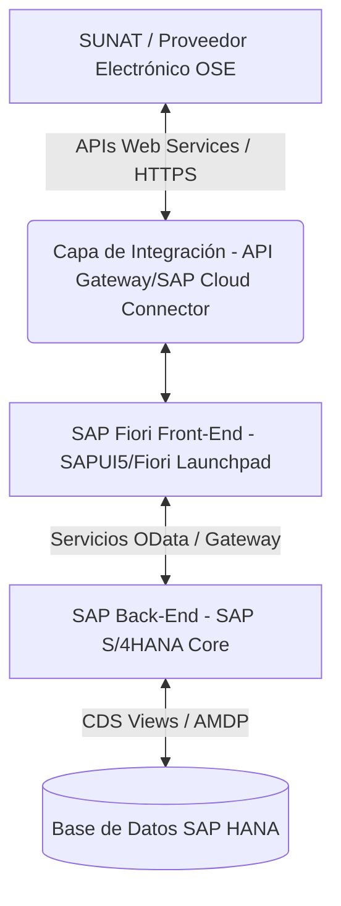
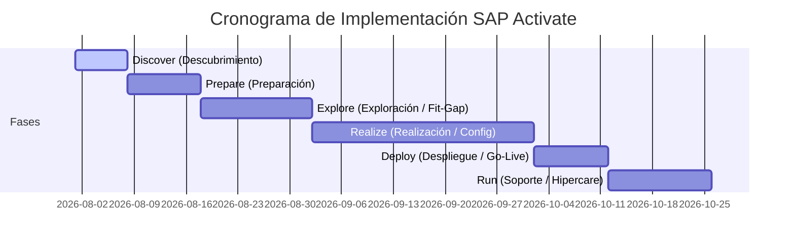

# Documento de Alcance de Solución (Statement of Work - SOW)
## Suite de Localización Perú: Libros Contables Electrónicos y Monitores Tributarios en SAP Fiori

---

### 1. Resumen Ejecutivo
El presente documento define el alcance técnico y funcional para la implementación de la **Suite de Localización Perú y Libros Contables Electrónicos** desplegada sobre la plataforma **SAP Fiori** y optimizada para bases de datos **SAP S/4HANA (o SAP HANA Database)**. 

La solución propuesta tiene como propósito reemplazar la experiencia de usuario tradicional basada en SAP GUI por una interfaz moderna, intuitiva, multiplataforma y centralizada en el **SAP Fiori Launchpad**. Esto permite un control tributario ágil en tiempo real, garantizando el 100% de cumplimiento de las normativas de la **Superintendencia Nacional de Aduanas y de Administración Tributaria (SUNAT)** de Perú, incluyendo los nuevos requerimientos del **Sistema Integrado de Registros Electrónicos (SIRE - RCE y RVIE)** y la generación de libros electrónicos para el **Programa de Libros Electrónicos (PLE)**.

---

### 2. Objetivos del Proyecto
*   **Modernización y Movilidad (UX):** Desplegar aplicaciones SAP Fiori Web responsivas (compatibles con laptops, tablets y smartphones) que reduzcan la curva de aprendizaje de los usuarios contables.
*   **Garantía de Cumplimiento Fiscal (Compliance):** Asegurar la compatibilidad inmediata con las normativas vigentes y futuras de SUNAT (SIRE RCE/RVIE, PLE, PDTs).
*   **Eficiencia Operativa en Tiempo Real:** Aprovechar la potencia de procesamiento en memoria de **SAP HANA** mediante la extracción directa de datos a través de **CDS Views**, eliminando la necesidad de procesos ETL lentos o programas Z pesados.
*   **Mitigación de Riesgos Tributarios:** Incorporar validaciones dinámicas previas al envío a SUNAT, reduciendo errores humanos y posibles multas por inconsistencias.

---

### 3. Arquitectura de Referencia y Enfoque Tecnológico
La solución aprovecha la arquitectura moderna de tres capas de SAP S/4HANA:

*   **Base de Datos SAP HANA:** Los datos contables (tablas `ACDOCA`, `BKPF`, `BSEG`, etc.) se consumen de manera directa mediante vistas de datos estructuradas (**Core Data Services - CDS Views**), asegurando máxima velocidad y el concepto de *"Single Source of Truth"* (Fuente Única de la Verdad).
*   **Servicios OData en SAP Gateway:** Exposición de los modelos de datos de SAP HANA hacia el Front-End de manera segura, paginada y optimizada.
*   **SAP Fiori Launchpad:** Menú centralizado y personalizado por roles que consolida el **Monitor de Localización Perú**.
*   **Capa de Integración:** Conexión segura mediante HTTPS a la SUNAT o a Proveedores de Servicios Electrónicos (OSE) para validaciones y sincronización del SIRE, Padrones y Retenciones Electrónicas.

---

### 4. Alcance Funcional Detallado (Módulos y Aplicaciones SAP Fiori)

El **Monitor de Localización Perú** en el Fiori Launchpad estará organizado en cinco (5) componentes principales:

#### Módulo 4.1: Mantenimiento y Configuración Base (Catalogo SUNAT)
Este módulo aloja las aplicaciones de configuración inicial de tablas y parámetros maestros exigidos por la SUNAT:
1.  **App: Configuración de Correlativos y Series (CRE/CPE/FEP):** Mantenimiento de rangos de numeración para comprobantes de pago electrónicos y físicos (Facturas, Boletas, Guías, Notas de Crédito, Comprobantes de Retención).
2.  **App: Autenticación de Servicios Web (OSE/SUNAT):** Configuración de credenciales de API, tokens de seguridad y accesos al Proveedor de Servicios Electrónicos (OSE) y SUNAT.
3.  **App: Homologación de Tablas Maestras SUNAT:** Mapeo de códigos internos SAP con catálogos oficiales de SUNAT para:
    *   Medios de Pago.
    *   Entidades Financieras.
    *   Unidades de Medida.
    *   Plan de Cuentas Nacional vs. Plan Corporativo.
    *   Aduanas y Puertos de Ingreso.

#### Módulo 4.2: Gestión de Libros Contables y Electrónicos (PLE y SIRE)
Generación, validación y descarga de archivos estructurados en formato plano (TXT) y ZIP listos para el PLE y el SIRE:
1.  **App: Libro de Inventarios y Balances:** Estructura completa de reportes contables:
    *   *Estado de Situación Financiera* (Balance General).
    *   *Detalle de Saldos por Cuentas:* Cuentas 12 y 13 (Cuentas por Cobrar Comerciales - Terceros / Relacionadas), Cuenta 14 (Cuentas por Cobrar al Personal, Accionistas, Directores), Cuenta 16 y 17 (Cuentas por Cobrar Diversas), Cuenta 19 (Estimación de Cuentas de Cobranza Dudosa), Cuenta 34 (Intangibles), Cuentas 42 y 43 (Cuentas por Pagar Comerciales - Terceros / Relacionadas), Cuentas 46 y 47 (Cuentas por Pagar Diversas), Cuentas 37 y 49 (Activo y Pasivo Diferidos).
    *   *Balance de Comprobación anual.*
    *   *Estado de Cambios en el Patrimonio Neto.*
    *   *Estado de Resultados* (Pérdidas y Ganancias por Función y Naturaleza).
2.  **App: Libro Diario y Detalle de Plan de Cuentas:** Generación del Libro Diario estándar y del Catálogo de Cuentas Utilizado.
3.  **App: Libro Mayor:** Reporte mensual detallado del Libro Mayor.
4.  **App: Registro de Activos Fijos:**
    *   *Detalle de Activos Fijos Revaluados y No Revaluados.*
    *   *Detalle de Diferencia de Cambio* asociada a activos.
    *   *Detalle de Activos Fijos bajo Arrendamiento Financiero (Leasing).*
5.  **App: SIRE - Registro de Compras Electrónico (RCE):**
    *   Integración directa con el Servicio Web de SUNAT para descargar la Propuesta de Compras (RCE).
    *   Pantalla de comparación interactiva de comprobantes registrados en SAP contra la propuesta de SUNAT.
    *   Generación de archivos de aceptación, reemplazo o inconsistencias (domiciliados y no domiciliados).
6.  **App: SIRE - Registro de Ventas e Ingresos Electrónico (RVIE):**
    *   Generación del Registro de Ventas a partir de la facturación en SAP SD/FI.
    *   Comparador contra la propuesta RVIE de SUNAT.
    *   Carga automática del archivo de Ventas (operaciones gravadas, exoneradas, inafectas, exportación, ISC, IGV, IVAP).
7.  **App: Registro de Inventario Permanente Valorizado (Kardex):** Reporte de control y valorización de inventarios bajo métodos SUNAT.

#### Módulo 4.3: Declaraciones y PDT SUNAT
Generación semiautomática de reportes y archivos de exportación en formato oficial para los aplicativos PDT de SUNAT:
1.  **App: Generador PDT 0601 (Planilla Electrónica - PLAME):** Interfaz para exportar datos de nómina/honorarios de SAP.
2.  **App: Generador PDT 0626 (Agentes de Retención):** Consolidado de retenciones efectuadas en el mes.
3.  **App: Generador PDT 0617 (IGV Otras Retenciones):** Reporte de retenciones de segunda categoría, no domiciliados, etc.
4.  **App: Generador PDT 0710 (Balance de Comprobación Anual):** Preparación del balance anual estructurado bajo las reglas de la SUNAT.

#### Módulo 4.4: Gestión de Detracciones y Retenciones
Automatización y control de flujos de fondos sujetos a detracciones y retenciones:
1.  **App: Monitor de Detracciones por Pagar (Proveedores):**
    *   Visualización de facturas de proveedores sujetas a detracción (SPOT).
    *   Agrupación y configuración de Lotes de pago para carga masiva en la plataforma del Banco de la Nación.
    *   Registro contable automático del pago de la detracción y actualización del número de constancia en el documento SAP.
2.  **App: Monitor de Autodetracciones (Clientes):** Control de cobros de facturas afectas a detracción por parte de clientes.
3.  **App: Monitor de Retenciones Electrónicas Integradas:**
    *   Detección de pagos sujetos a retención en SAP FI.
    *   Emisión del Comprobante de Retención Electrónica (CRE) interactuando en tiempo real con SUNAT/OSE.
    *   Envío automatizado del comprobante (XML/PDF) al correo electrónico del proveedor.

#### Módulo 4.5: Padrones y Tesorería
Herramientas de control de riesgos y optimización de tesorería:
1.  **App: Actualización y Validación Masiva de Padrones SUNAT:**
    *   Carga masiva automatizada de padrones oficiales de SUNAT (Buenos Contribuyentes, Agentes de Retención, Agentes de Percepción, Contribuyentes No Habidos / Estado APORTAR).
    *   Validación automática en procesos de compras/pagos (bloqueo preventivo de pagos a proveedores "No Habidos").
2.  **App: Gestión de Pago a Proveedores:** Consolidación de propuestas de pago y generación de planillas/archivos TXT formateados para los principales bancos nacionales (BCP, BBVA, Scotiabank, Interbank).
3.  **App: Extractos Bancarios y Reporte de Conciliación Bancaria:**
    *   Procesamiento e importación automatizada de extractos en formatos estándar (MultiCash, MT940).
    *   **Dashboard Fiori de Conciliación Bancaria:** Filtros interactivos de búsqueda de partidas pendientes, autoconciliación por algoritmos de reglas y reportes visuales de partidas conciliadas vs. no conciliadas.

---

### 5. Metodología de Implementación (SAP Activate)

El proyecto se ejecutará bajo la metodología oficial **SAP Activate**, la cual combina agilidad y el uso de mejores prácticas:

1.  **Discover (Descubrimiento):** Demostración del producto estándar, revisión de prerrequisitos del sistema y accesos.
2.  **Prepare (Preparación):** Planificación del proyecto, asignación de equipos, configuración inicial del entorno de desarrollo (Sandbox/Dev) y habilitación de SAP Fiori Cloud o local.
3.  **Explore (Exploración):** Talleres de diseño (Fit-to-Standard), validación del mapeo de cuentas contables peruanas y definición de brechas técnicas (Gaps) o integraciones específicas.
4.  **Realize (Realización):** Configuración de la Suite en SAP S/4HANA, desarrollo/ajuste de CDS Views y lógica de negocio OData, personalización de aplicaciones Fiori, pruebas unitarias y pruebas integrales (UAT).
5.  **Deploy (Despliegue):** Migración de configuraciones a Producción, capacitación a usuarios finales (Key Users), corte contable y salida en vivo (Go-Live).
6.  **Run (Operación):** Soporte post-implementación (hipercare) y pase a mantenimiento continuo.

---

### 6. Entregables del Proyecto

| Fase (SAP Activate) | Entregable Principal | Descripción / Formato |
| :--- | :--- | :--- |
| **Prepare** | Plan de Proyecto y Acta de Inicio (Kick-off) | Documento con cronograma detallado y matriz de riesgos. |
| **Explore** | Documento de Diseño Funcional y Técnico (BBP) | Detalle de las parametrizaciones y lógica de mapeo SUNAT. |
| **Realize** | Solución Configurada y Desarrollada | Aplicaciones desplegadas en Fiori Dev/QAS y CDS Views activas. |
| **Realize** | Plan y Matriz de Pruebas de Usuario (UAT) | Registro firmado de escenarios de negocio probados. |
| **Deploy** | Manuales de Usuario y Técnico | Guías detalladas de uso de las aplicaciones SAP Fiori. |
| **Deploy** | Estrategia de Transporte y Go-Live | Lista de órdenes de transporte validadas y ordenadas. |
| **Run** | Acta de Cierre de Proyecto | Formalización de la entrega y paso a soporte de mantenimiento. |

---

### 7. Premisas y Exclusiones

#### 7.1. Premisas (Requisitos del Cliente)
*   **Acceso e Infraestructura:** El cliente deberá garantizar conectividad a los ambientes de desarrollo (DEV), calidad (QAS) y producción (PRD), así como accesos de administración al SAP Fiori Frontend Server y SAP Gateway.
*   **Calidad de Datos:** Es responsabilidad del cliente la limpieza y depuración de sus datos maestros (RUCs de proveedores/clientes, asignaciones de cuentas contables).
*   **Conectividad SUNAT/OSE:** El cliente proporcionará los accesos y credenciales de producción para la interacción de Web Services con SUNAT y su respectiva OSE.

#### 7.2. Exclusiones
*   Licenciamiento de software SAP, bases de datos o servicios en la nube de SAP.
*   Desarrollo de integraciones con sistemas externos que no sean los indicados en este documento (SUNAT/OSE/Bancos nacionales).
*   Configuración o corrección de procesos contables estándar de SAP FI (por ejemplo, conciliaciones bancarias mal ejecutadas en períodos anteriores).

---

### 8. Roles y Responsabilidades (Matriz RACI)

*   **R** (Responsable de Ejecución): Quién realiza la tarea.
*   **A** (Aprobador final): Quién responde por el resultado y tiene la última palabra.
*   **C** (Consultado): Aporta información para la tarea.
*   **I** (Informado): Se le notifica el resultado.

| Tarea / Actividad | Partner SAP (Nosotros) | Equipo de Proyecto Cliente | Sponsor / Dirección |
| :--- | :---: | :---: | :---: |
| Definición del Plan de Proyecto | **A / R** | **C** | **I** |
| Configuración Base de Localización en SAP S/4HANA | **R** | **C / I** | **I** |
| Desarrollo de CDS Views y OData Services | **A / R** | **I** | **I** |
| Configuración de Roles y Perfiles SAP Fiori | **R** | **R / C** | **I** |
| Ejecución de Pruebas de Aceptación de Usuario (UAT) | **C** | **A / R** | **I** |
| Aprobación de Salida en Vivo (Go-Live) | **C** | **R** | **A** |
| Capacitación a Usuarios Finales | **R** | **C** | **I** |
